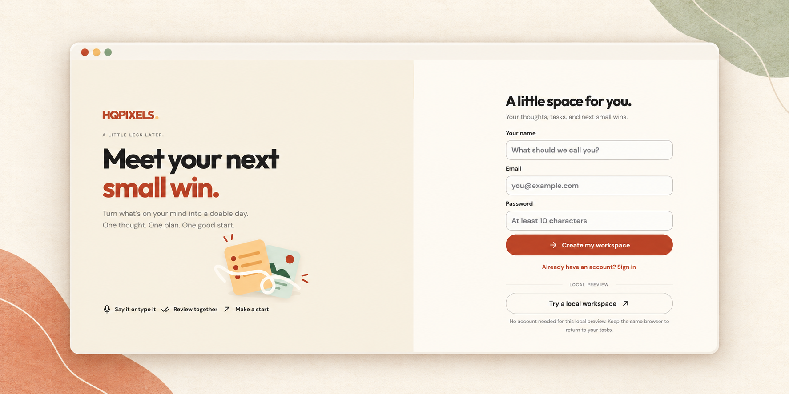
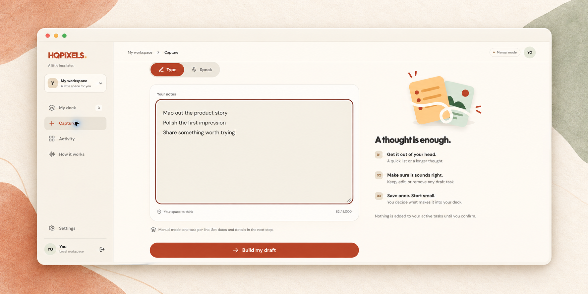
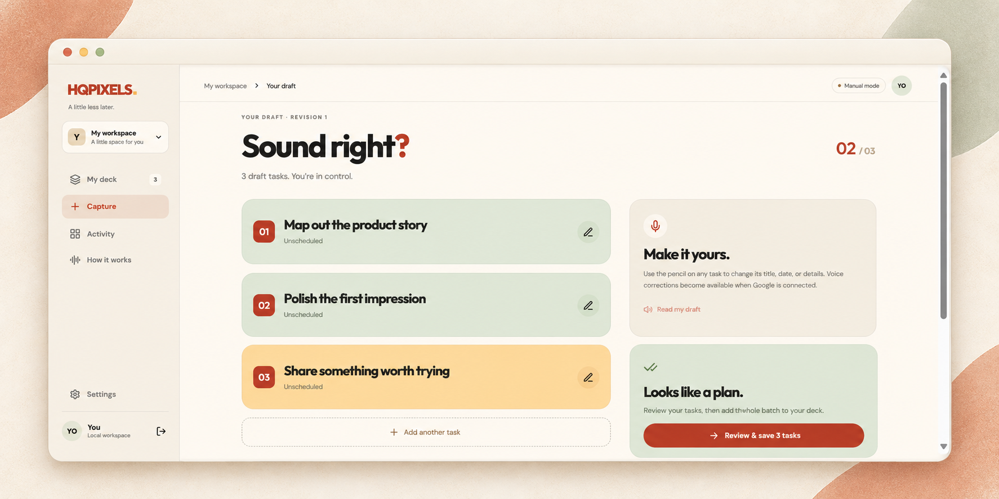
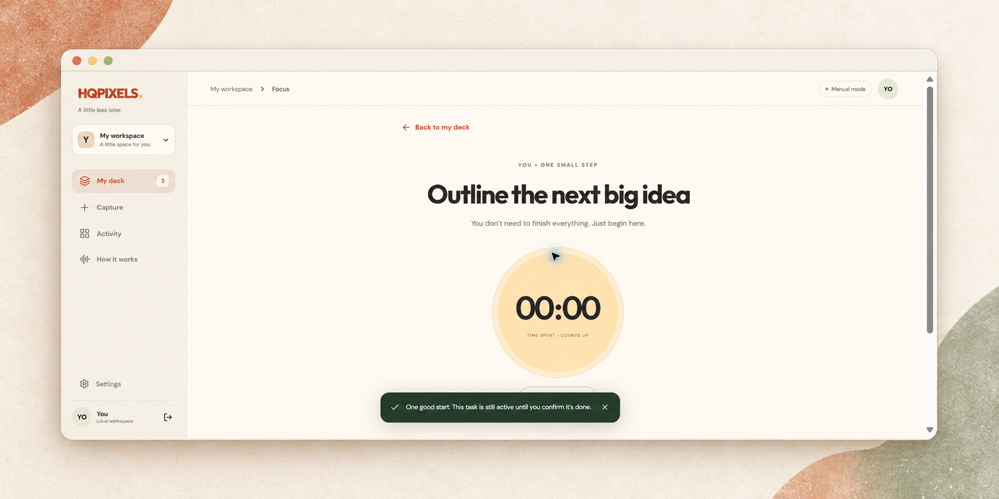

<div align="center">

# HQPIXELS

### Meet your next small win.

Turn what’s on your mind into a doable day.<br>
Capture a thought. Review the plan. Make a start.

**[Open the app](https://hqpixels.com) · [Run locally](#run-locally) · [Implementation guide](hqpixels-app/README.md)**

React · TypeScript · Express · SQLite / PostgreSQL · Optional Gemini

</div>



## A little less later.

HQPIXELS is a task workspace built around small, deliberate steps. Get a list out of your head, shape it into a draft, and choose one thing to begin. A warm cream palette, terracotta accents, soft green panels, and tactile cards keep the experience calm and approachable.

Manual mode works without an API key. Optional Google Gemini integration adds recorded voice capture, task interpretation, corrections, spoken lookup, and read-back.


## From a thought to a first step

<table>
<tr>
<td width="50%"><strong>01 · Capture the chaos</strong><br>Type one task per line, or use recorded voice with a configured provider.</td>
<td width="50%"><strong>02 · Make it yours</strong><br>Edit the draft, review the batch, and explicitly confirm what gets saved.</td>
</tr>
<tr>
<td></td>
<td></td>
</tr>
</table>

**03 · One good next step.** Browse or swipe the deck, open focus mode, and start the timer. Completion stays in your hands; history lets you reopen a task.



<sub>AI-styled presentation previews based on application screenshots with fictional sample tasks. Framing and fine visual details may differ from the running app. Manual mode is shown; voice requires server configuration. <a href="docs/screenshots/">View the original screenshots.</a></sub>

## What works today

| Experience | Included |
| --- | --- |
| Capture | Quick deck saves, manual drafts, optional recorded audio and AI interpretation |
| Review | Editable titles, dates, durations and notes; batch confirmation; revision checks |
| Task deck | Search, filters, swipe actions, keyboard shortcuts and focus mode |
| Progress | Complete, reopen, reschedule, archive, restore and activity history |
| Persistence | Local SQLite, PostgreSQL adapter, browser note caching and JSON export |
| Accounts | Email/password sign-in, isolated workspaces and local guest preview |

## Run locally

Use **Node.js 22.13 or newer** with `node:sqlite` support.

```sh
git clone https://github.com/PCTEJA/REPLIT_INTERNSHIP_COMPETITION.git
cd REPLIT_INTERNSHIP_COMPETITION/hqpixels-app
npm ci
npm run dev
```

Open **http://127.0.0.1:3000** and select **Try a local workspace**. No API key or database service is needed for manual mode.

For optional configuration, copy `hqpixels-app/.env.example` to `hqpixels-app/.env` only if that file does not already exist. Keep credentials on the server. Local data lives in `hqpixels-app/data/`; environment files and databases are excluded from Git.

See the [implementation guide](hqpixels-app/README.md) for Google configuration, persistence details, production settings, and the manual walkthrough.

## Built with

| Layer | Technology |
| --- | --- |
| Interface | React 19, TypeScript, Vite, Lucide, DM Sans and Outfit |
| Server | Node.js, Express 5, Zod |
| Storage | SQLite for local development; PostgreSQL for production |
| Optional AI | Google GenAI SDK, audio understanding and speech generation |
| Deployment | Vercel configuration and Replit configuration included |

Draft creation and task commitment are separate operations. The server validates changes, checks workspace ownership, and rejects stale revisions and duplicate operations. Provider output cannot directly execute a task write.

## Verify the project

From `hqpixels-app`:

```sh
npm test
npm run build
```

**15 tests passed; the production build passed on October 26, 2026.** The build includes TypeScript checking. Tests cover task workflows, authentication, workspace isolation, persistence, duplicate operations, stale revisions, provider failures, and audio validation. Provider tests use mocks.

This is an MVP. Physical microphone capture and the PostgreSQL deployment path still need end-to-end verification. Account recovery, email verification, calendar integrations, notifications, and native widgets are future work. Manual input splits lines; it does not infer dates. The focus timer resets on refresh.

## Explore the design

The implementation follows the selected **FLIP** direction: warm paper, expressive type, playful task cards, and one clear next action.

<details>
<summary><strong>View the framed mobile design concepts</strong></summary>
<br>
<table>
<tr>
<td width="33%"></td>
<td width="33%"></td>
<td width="33%"></td>
</tr>
</table>

These are generated design references, not screenshots of implemented features. The earlier 60-frame study explores FLIP, ORBIT, and FOLIO.

</details>

| Start here | What you’ll find |
| --- | --- |
| [Application](hqpixels-app/README.md) | Setup, architecture, deployment and implementation boundaries |
| [Product brief](hqpixels/PROJECT-BRIEF.md) | Product intent and interaction specification |
| [Build backlog](hqpixels/BUILD-BACKLOG.md) | Planned work and acceptance criteria |
| [Design package](hqpixels/README.md) | Selected direction and visual references |
| [Original design study](design-frames/START-HERE.md) | Three directions across sixty frames |

---

<div align="center"><strong>Little steps. Real progress.</strong><br>HQPIXELS</div>
