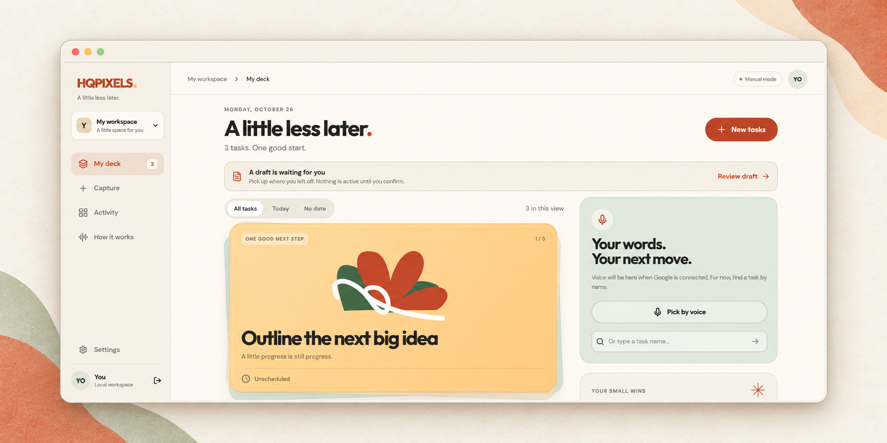

# HQPIXELS — FLIP implementation

HQPIXELS (HQ for short) turns a set of thoughts into reviewable tasks. This local MVP uses the selected FLIP palette and card-based design, with manual entry selected by default.



<sub>AI-styled presentation based on the implemented interface; fine visual details may differ. [Original application screenshots](../docs/screenshots/).</sub>

## Run locally

Use Node.js 22.13 or newer with `node:sqlite` support. From this folder:

```sh
npm ci
npm run dev
```

Open http://127.0.0.1:3000 and choose **Try a local workspace**, or create an email/password account. No Google key is required for manual mode. SQLite data is stored in `data/hqpixels.sqlite`; keep that directory to preserve your workspace. Local guest access lasts for the browser session cookie's seven-day lifetime; register an account for repeat sign-in.

To use environment settings, copy `.env.example` to `.env` only if `.env` does not already exist. Do not overwrite an existing configuration. Keep `.env` private.

## Try the manual flow

1. Open **Capture → Type** and enter one task per line, up to twenty tasks. Leave Google interpretation off.
2. Create the draft. Use each card's pencil to edit the title, date, duration, and notes. Remove a task from the batch, add a task, or undo an edit.
3. Choose **Review & save**, inspect the summary, then **Confirm & save**. Drafting alone never creates active tasks.
4. Find tasks in **My deck**, search by task name, and start a focus session.
5. Mark completion explicitly. Activity supports reopening, rescheduling, archiving, and restoring tasks.

Manual mode splits lines; it does not interpret phrases such as “next Friday.” Set the date on the review card. Unsubmitted typed notes are cached on this device. Draft changes save with **Save draft changes**, before confirmation, or when navigating to another page. Unsaved card edits can be lost on browser refresh. The focus timer resets on refresh.

## Google voice and assistant integration

The server adapter is implemented for recorded audio understanding, task extraction, conversational corrections, spoken task selection, and optional read-back. This is a record-and-submit interaction, not a continuous realtime voice call. Recordings stop at sixty seconds and are sent only when the user continues.

Set `GEMINI_API_KEY` in server environment settings or Replit Secrets. `GEMINI_TASK_MODEL` must be a currently available Gemini model supporting audio input and structured JSON output; `GEMINI_TTS_MODEL` must support audio output. The default task model is `gemini-3.1-flash-lite`; read-back uses `gemini-2.5-flash-preview-tts`. Both were live-verified with this project on October 25, 2026. The private local `.env` contains the configured project key and is excluded from Git; deployments need their own server secret. A “Google configured” indicator means a key exists, not that credentials, model access, quota, or billing have been validated. Typing remains the default even when a key exists.

Voice confirmation is available only after the summary is displayed. A clear supported save phrase with an unchanged draft may confirm that summary. A correction returns to review. Google output cannot itself execute a database write or complete a task.

Automated tests use mocked Google responses. Separate live checks verified text extraction, generated speech, and transcription/task extraction from a synthetic spoken sample. Google API free-tier access is limited by model and quota; do not assume an AI Pro subscription provides unlimited API use. Check the project's access and usage in AI Studio and the current [Google billing documentation](https://ai.google.dev/gemini-api/docs/billing). Recordings are processed in memory and are not stored by this app; transcripts and task notes are stored in the workspace. Google's own data terms apply to provider processing.

## Replit setup

Import the contents of this folder as the Replit project root so `.replit` and `package.json` are at the root. Run `npm ci`, then Run. The included development command binds to `0.0.0.0` and exposes port 3000.

For production, configure a PostgreSQL database and these server secrets/settings:

| Setting | Value |
| --- | --- |
| `DATABASE_URL` | PostgreSQL connection string provided by your database |
| `APP_ORIGIN` | Exact HTTPS published origin, without a trailing slash |
| `NODE_ENV` | `production` |
| `HOST` | `0.0.0.0` |
| `PORT` | `3000` |
| `GEMINI_API_KEY` | Optional; omit for manual-only use |
| `AI_DAILY_LIMIT` / `AI_GLOBAL_DAILY_LIMIT` | Optional request caps; defaults 30 per user and 300 globally |

The deployment config runs `npm ci && npm run build`, then `npm start` with production settings. Production startup requires PostgreSQL and an HTTPS origin; local guest login is disabled. Database tables are created automatically. Never upload `.env`, `data/`, `node_modules/`, or credential screenshots. See [Replit configuration](https://docs.replit.com/features/project-setup/configuration).

The app has not been deployed to Replit. The PostgreSQL adapter and deployment settings still need integration testing in the target environment. Capture processing currently runs inside the web process: a terminated instance can interrupt a run, which becomes a recoverable error. A durable job queue is needed for reliable processing across autoscaling instances.

## Verification and boundaries

Verified locally: `npm run check`, `npm test` (15 passing tests), and `npm run build`. Tests cover manual capture/review/commit, duplicate requests, stale revisions, workspace isolation, authentication, CSRF/origin checks, database rollback and persistence, canceled/failed mocked AI runs, stale corrections, run timeout recovery, and WAV validation. Provider tests use mocks and never call Google.

Live Google checks on October 25, 2026 passed for task extraction, speech generation, and a synthetic audio-to-draft round trip (including a twenty-minute duration). The previously configured `gemini-3.8-flash` returned deadline errors, and Google rejected `gemini-2.5-flash` for this new account; the local task model now uses the verified `gemini-3.1-flash-lite`. Physical microphone capture, responsive layouts, keyboard interaction, and PostgreSQL deployment remain unverified.

This is a local MVP, not a production launch certification. Account recovery and email verification are not implemented. Workspaces have a 500-task and 10,000-operation cap; the last 60 runs and 20 draft revisions are retained. Export is available as JSON, but import is not implemented. Time-of-day scheduling, external calendar/email execution, notifications, and native widgets remain future work.

## Source map

- `client/src/`: React interface, recorder, IndexedDB note cache, styles.
- `server/`: Express routes, Google adapter, validated task operations, SQLite/PostgreSQL store.
- `shared/types.ts`: shared contracts.
- `public/`: microphone AudioWorklet and generated PNG brand asset.
- `tests/app.test.ts`: isolated API and persistence tests.

Design references and the broader product backlog live in the sibling `hqpixels/` folder in the original workspace. Those documents describe the full intended product; this README describes what the current implementation does.
