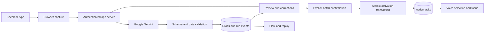

# HQPIXELS — speak it, shape it, start it

Project draft · October 25, 2026 · Selected visual direction: **FLIP** · Compact brand: **HQ**

This is the product and implementation specification. The accompanying PNGs are design concepts; the Google integration, server, database and deployed app have not been built in this delivery. This document supersedes the earlier three-direction handoff wherever behavior differs.

## 1. Product promise

HQPIXELS turns a spoken brain dump into a clear, editable task plan. People can speak several tasks at once, review what the assistant understood, correct it conversationally, and save the whole batch. They can also find and start an existing task by saying its name. Typing, tapping and optional swiping remain fully supported.

The assistant organizes work. A task called “Email my tutor” does not send email. Saving, starting and completing a task are distinct actions. Only the user can confirm completion.

Primary audience: students and busy individuals who know what they need to do but find manual entry and repeated task selection tiring. Success means less interaction effort while retaining control over the plan.

## 2. Brand and visual direction

The final name is **HQPIXELS**, written as one uppercase word. Use **HQ** for the app icon and compact navigation. The Q’s small pixel accent connects the shortcut to the full name. The spoken assistant can simply be called “HQ”; a wake word is not required.

Keep FLIP’s warm ivory canvas, apricot task cards, burnt-vermilion actions, sage support colors, confident rounded sans headings and tactile paper motifs. Preserve its friendly hierarchy and generous touch areas. Reduce decorative artwork on recording and review screens so the user’s words remain prominent.

| Token | Value / intent |
| --- | --- |
| Canvas / surface | #FFF8EE / #FFFCF6 |
| Primary / on-primary | #B94326 / #FFF8EE |
| Ink / secondary text | #26221F / #655D55 |
| Task art / support | #FFCB85 / #D8E5D5 |
| Focus outline | #7E2F1D |
| Heading type | Bold rounded sans; use a properly licensed family |
| Body type | Clear sans, minimum 16 CSS px for inputs |
| Card / button radius | 28px / pill |
| Touch controls | At least 48 × 48 CSS px |

Use the PNG lockup as the branding reference. The app itself must use accessible HTML components, not screenshot backgrounds. Text scales and cards grow. Respect reduced motion and visible keyboard focus. The original FLIP frames remain archived references; all production branding, titles, loading states, installation metadata and sharing previews must say HQPIXELS.

## 3. Core journey

1. **Capture:** choose Speak or Type. Ask for microphone permission only after an intentional mic action. Record up to 60 seconds per turn, then stop; longer thoughts can be added in another turn.
2. **Understand:** send the recording to the application server and Google Gemini. Return a transcript and candidate tasks. A recording waveform indicates sound level, not transcription progress.
3. **Review:** show all candidates together with an editable transcript, clear task numbers, dates and any questions. All are drafts. No per-task checkbox is mandatory.
4. **Refine:** “Move the essay to Friday,” “Remove task two,” or “Add buying groceries.” Apply changes to the draft, visibly highlight changed fields and offer Undo. Manual editing is always available.
5. **Confirm:** “Save these three tasks” or the Save button activates the current reviewed batch. Confirming the batch never marks tasks completed.
6. **Choose:** “Show my tasks for today,” “Start the essay,” or “What can I do in ten minutes?” brings the relevant tasks forward. When several tasks match, ask which one.
7. **Finish:** focus on one task; explicitly confirm completed work. The app persists the completion and optional reward once.

Voice interaction begins with a tap or keyboard action because the browser needs permission and an explicit listening session. There is no background listening. In the first release, users take short recording turns; always-on conversation is a later enhancement.

### Example conversation

Demo context: Monday, October 26, 2026, America/Chicago.

**User:** “I need to outline my essay for tomorrow, email my tutor, and book a study room.”

**HQ:** “I found three tasks: outline the essay for Tuesday, October 27; email your tutor; and book a study room. The last two have no date yet. Want to change anything?”

**User:** “Move the essay to Friday, and email my tutor today.”

**HQ:** “Updated: essay Friday, October 30; email today, October 26; study room unscheduled. Save these three tasks?”

**User:** “Save all three.”

**HQ, after database commit:** “Saved three tasks.”

**User:** “Start the email task.”

**HQ:** Opens the matching focus screen. No card-by-card selection is needed, and no email is sent.

The initial utterance did not specify durations, so durations remain unset. If the product suggests one later, label it “Suggested” and let the user accept or edit it.

## 4. Voice command contract

| User intent | Example | Result |
| --- | --- | --- |
| Create several drafts | “Call Dad, buy milk, finish the slides” | Three candidate drafts; no active tasks yet |
| Review / read back | “Read my draft” | Show and optionally speak the current draft |
| Correct a field | “The essay is due Friday” | Change that draft, show resolved date, increment revision |
| Exclude a draft | “Remove the second one” | Exclude from batch with Undo |
| Select a subset | “Save only the essay and email” | Present the selected set, then confirm that set |
| Confirm current batch | “Save these tasks” | Activate the current reviewed revision atomically |
| Query saved tasks | “Show today’s tasks” | Filter only the authenticated user’s saved tasks |
| Pick / start | “Start the email task” | Resolve the task and open focus; no completion award |
| Reschedule | “Move my email task to tomorrow” | Preview the new date for a saved task, confirm, then apply |
| Complete | “I finished the essay” | Show/read the target and ask for completion confirmation |
| Undo | “Undo that change” | Reverse the last eligible operation; identify its target |
| Ambiguous reference | “Start that one” with several matches | Ask a short question; do not guess |

Commands are scoped to capture, draft review or saved tasks. The interpreter receives the current UI context and stable task IDs. “Second” refers to the displayed ordering of the current revision, never an arbitrary database order. The server independently checks the resolved target belongs to the user.

### Confirmation and concurrent edits

The server issues a short-lived confirmation token bound to user ID, draft ID, revision and selected-task hash after presenting a summary. A spoken save instruction is a new user turn in review mode. It is never extracted from the original brain dump or the assistant’s own audio. Silence, a transcription failure, “don’t save,” and an unclear “okay” do not commit.

A mixed command such as “Move it to Friday and save everything” first changes the draft and presents the revised summary; it requires a fresh confirmation. A typed edit invalidates any pending voice proposal. Commit compares the revision in a transaction and rejects a stale confirmation with a friendly request to review the latest changes. Double-clicks, repeated voice requests and network retries reuse an operation ID.

## 5. Screen and state specification

| Screen | Required behavior |
| --- | --- |
| Welcome | HQPIXELS identity, Speak my tasks, I’d rather type, clearly labeled sample mode |
| Capture | Speak/Type tabs, recording indicator, elapsed time, stop and cancel; preserve text when switching modes |
| Processing | Real progress states; cancel request; preserve input when a provider fails |
| Draft review | Numbered task rows, editable transcript, Speak changes, manual edit/remove/undo, batch save; optional Read aloud |
| Clarification | One concise question, examples or date picker, option to leave a nonessential field unset |
| Task deck | Existing FLIP cards, prominent voice task selector, query results; optional swipe and tap controls |
| Focus | Current task and timer, pause/exit, completion confirmation; starting never awards XP |
| Activity | Saved/completed tasks, overdue “Needs a plan,” reschedule/drop without shaming |
| Flow | Real per-step run events, safe summaries, actual durations, recovery and replay |
| Settings | Language, timezone, voice playback, privacy/delete options, microphone help |

Capture state machine: idle → requesting permission → recording → stopped → uploading → understanding → review. Error, cancel and retry branches return to a usable preserved state. At 60 seconds recording stops locally and offers Continue; it does not auto-upload merely because the timer elapsed. Stop & review is an explicit upload action.

Review states: draft → editing → revised draft → awaiting confirmation → saving → saved. Late results from canceled runs must not replace newer edits. Disable duplicate saves while one operation is pending; show “Saved” only after durable database confirmation.

Review voice controls use the same mic recorder as capture, with a short correction turn. “Read aloud” plays a Google-generated summary of the canonical draft; keep visible text, stop playback on request and pause recording while playback is active in the turn-based MVP. Never record the assistant’s voice as a user command.

### Relationship to the original 20 FLIP frames

Frames 01–04 receive the new HQPIXELS/voice designs in this package. Frames 05–08 remain optional swipe, commitment and reschedule interactions; add voice equivalents without changing their visual character. Frames 09–11 retain focus, explicit completion and celebration. Frames 12–14 remain the optional buddy and activity expansion. Frames 15–18 show the real voice/text pipeline and replay. Frame 19 is local draft recovery; Google processing still needs a network connection. Frame 20 remains a separate future native widget project.

The four new screen PNGs illustrate the new core journey. The other original raster frames have not been individually regenerated or silently relabeled as new artwork. Their implementation specification is updated here.

## 6. Google API approach

Use the **Gemini Developer API** for understanding recorded audio and interpreting typed requests. Use a Google Gemini TTS model for the optional spoken read-back. This meets the Google preference without requiring a separate speech-to-text vendor. Gemini supports audio understanding and structured responses. [Audio documentation](https://ai.google.dev/gemini-api/docs/audio), [structured output documentation](https://ai.google.dev/gemini-api/docs/structured-output).

The first release is turn-based: record → stop → process → review. It does not promise live transcription while recording. Google’s Live API is the separate path for continuous speech, interruptions and real-time spoken responses. Add it after the reviewed-task contract works reliably. [Live API](https://ai.google.dev/gemini-api/docs/live-api).

TTS accepts canonical summary text and returns audio. Its failure must not block text review or task saving. A visible playback button is required; do not rely on autoplay. [Google speech generation](https://ai.google.dev/gemini-api/docs/speech-generation).

### Free tier and your AI Pro account

“Google API” is not a blanket unlimited-free product. Some Gemini models have free API tiers; access and quotas depend on the model and project. Rate limits are shared across a project’s keys. Check the actual project dashboard before promising any capacity. Free-tier data handling also differs from paid tiers; disclose the applicable terms before uploading personal notes. [Pricing](https://ai.google.dev/gemini-api/docs/pricing), [rate limits](https://ai.google.dev/gemini-api/docs/rate-limits).

Google AI Pro’s AI Studio interface benefits are distinct from programmatic API usage. Google currently advertises $10/month in Cloud credits for eligible Pro subscribers. Activation, billing linkage and credit availability must be checked; a subscription alone does not prove HQPIXELS has usable API quota. Prepay accounts may require a positive paid balance before promotional credits apply. No paid billing has been enabled here. [Google AI plans and API distinction](https://ai.google.dev/gemini-api/docs/google-ai-plans), [Google’s Pro benefit announcement](https://blog.google/innovation-and-ai/technology/developers-tools/gdp-premium-ai-pro-ultra/).

Use the Google account you identified as **your intended Google account** when opening AI Studio and the developer benefits dashboard. The account’s full email, ownership, current credit balance and project access were not inspected in this work. Do not put an account identifier or API key into public source or UI.

### Setup checklist for the build

1. Sign into [Google AI Studio](https://aistudio.google.com/) using your intended account. Create/select a dedicated HQPIXELS development project and API key.
2. Inspect available models, free quotas and billing status. Start without paid billing if the needed models are eligible. Do not automatically upgrade when limits run out.
3. Inspect [developer benefits](https://developers.google.com/program/my-benefits) separately if you want to claim Pro credits. Verify credit applicability and expiry before relying on them.
4. Store `GEMINI_API_KEY` in Replit Secrets/server environment. Never in a `VITE_` variable, browser bundle, repository, screenshot or chat.
5. Configure `GEMINI_TASK_MODEL` and `GEMINI_TTS_MODEL` server-side after a real capability test. The current docs show `gemini-3.8-flash` for audio/structured-output examples and `gemini-3.8-flash-tts` for speech; these are candidate IDs, not a guarantee of account eligibility or free availability. Check [model lifecycle](https://ai.google.dev/gemini-api/docs/deprecations) before implementation.
6. Run one short audio request, one typed extraction, one correction and one read-back. Record model IDs, SDK version, latency, errors and usage from actual responses.
7. Add per-user and global application quotas. If Google quota is exhausted, keep manual task entry usable and explain when to retry. Never switch to a paid model silently.

## 7. Proposed Replit architecture

This is a proposed implementation stack, not installed application code: React + TypeScript client, Node/TypeScript server, PostgreSQL database, Google GenAI SDK, schema validation, and server-sent events for run updates. Confirm the current Replit database, auth and deployment options during build. Use one same-origin backend and managed authentication with owner isolation.

The model proposes data; the server owns validation, authorization, revisions and transactions. Tools exposed to the model are restricted to draft proposals and task queries. The provider does not receive database credentials or arbitrary execution tools. Confirmation lives in application logic.

### Capture and storage

Use browser microphone APIs on HTTPS or localhost. Check recorder format support at runtime. Match actual audio MIME type to the provider request; transcode unsupported containers on the server with a bounded job. Stop media tracks on cancel, route change and timeout. Proposed product caps: 60 seconds, 10 MiB per recording, 8,000 characters per typed turn, 20 task candidates. Validate caps on the server, not just in the browser.

Store text drafts and correction history durably. Raw audio is transient: retain it only through processing/retry, remove server temporary files on success/failure/cancel, and clean abandoned files with a short expiry. If Google’s file upload service is used, explicitly delete uploaded files when no longer needed and document provider retention separately. Do not promise that deleting our copy deletes provider logs.

Use IndexedDB for local draft text and unsynced edits; label “Saved on this device.” Do not store audio offline by default. Offer explicit retry from an in-memory recording if the tab remains open; otherwise let the user rerecord or type. Never claim a failed audio transcription has a local transcript. Browser storage clearing can remove local drafts.

### API surface

| Endpoint | Contract |
| --- | --- |
| POST /api/captures | Authenticated text or multipart audio; operation ID, timezone, locale; returns capture/run ID |
| GET /api/runs/:id/events | SSE with sequence IDs; reconnect from last event; owner-only |
| GET /api/drafts/:id | Canonical tasks, transcript, questions and revision |
| PATCH /api/drafts/:id | Manual edit; expected revision and operation ID |
| POST /api/drafts/:id/turns | Typed or recorded correction; expected revision; returns proposed canonical revision |
| POST /api/drafts/:id/confirmation | Generate summary/token for current revision and selected IDs |
| POST /api/drafts/:id/commit | Valid confirmation token, operation ID, expected revision; one atomic batch |
| POST /api/task-queries | Natural-language lookup of the current user’s tasks; no mutation |
| POST /api/task-actions/propose | Resolve start, reschedule, completion or undo target; return disambiguation if needed |
| POST /api/task-actions/confirm | Validate target/version and confirmation for persistent action |
| POST /api/readback | Google TTS for canonical draft summary, bounded length; owner-only |
| GET /api/runs/:id/replay | Persisted events only; never calls Gemini or reruns mutations |

Proposed errors: 400 invalid input, 401 unauthenticated, 403 forbidden, 409 stale revision, 413 too large, 415 unsupported audio, 422 unresolved interpretation, 429 quota exceeded, 502 provider failure, 503 storage unavailable. Return safe human-readable messages and retry hints; never provider keys or raw stack traces.

## 8. Data model and integrity

| Entity | Key fields / constraints |
| --- | --- |
| users | ID, auth subject, locale, IANA timezone, preferences |
| captures | ID, owner, source type, transcript, original text, state, timestamps; no durable raw audio by default |
| drafts | ID, capture ID, owner, revision, status, confirmed revision |
| draft_tasks | Stable ID, draft ID, title, notes, source quote, due phrase/date/time/zone, priority, duration, clarification state, excluded flag |
| draft_turns | ID, draft ID, base/result revisions, user text, proposed changes, outcome |
| tasks | ID, owner, unique source draft-task ID, state, version, due fields, timestamps |
| operations | Unique (owner ID, operation ID), request hash, status and result; reject key reuse with different payload |
| confirmations | Hash/token, owner, target revision, selected IDs hash, expiry and consumed state |
| runs / run_events | Owner, capture, provider/model; unique (run ID, sequence), step, actual timing, redacted summary |
| completion_events | Unique operation/completion ID, task, reversal link; reward once per eligible completion |

Draft commit locks/checks the draft revision, validates all selected IDs, inserts active tasks and the operation result, marks the draft committed and consumes the confirmation in one transaction. A retry returns the same result. A partial database failure rolls back the batch. Starting a task and awarding completion are separate operations.

### Dates and uncertainty

Pass the user’s current timestamp and IANA timezone to interpretation. Preserve the original phrase. A date-only task stores a local calendar date, not an arbitrary UTC midnight. Store an instant plus timezone only when a time is actually supplied. Ask about ambiguous “next Friday,” ambiguous numeric dates, missing AM/PM, daylight-saving conflicts and unclear references when consequential. A missing optional due date may remain unscheduled.

Task extraction preserves negation, conditional language and repetitions. “Don’t email Sam” is not an email task. Questions and background observations are not automatically tasks. Deduplication can suggest merges; it does not silently delete intentional separate tasks. Estimates and priorities are not invented as user facts.

## 9. Run visibility and recovery

Stable steps: `receive_input` → `validate_input` → `understand_input` → `validate_tasks` → `save_draft` → `render_review`. Corrections have their own run linked to the draft. Confirming produces a separate `commit_tasks` event; human review time is never included in a model latency figure.

Measure durations at the layer that performs the operation. `understand_input` may encompass transcription plus extraction in one provider request; do not fabricate separate timings. `render_review` comes from a client acknowledgment and is labeled client-measured. Persist events before streaming them. Reconnect by sequence ID; replay stored events without side effects. Hide raw transcripts/audio from public diagnostic views.

| Failure | Recovery |
| --- | --- |
| Permission denied / unavailable mic | Plain explanation, browser help, immediate Type option |
| Silence / unintelligible speech | No invented tasks; rerecord or type |
| Unsupported audio | Bounded conversion or honest format error; preserve recoverable input |
| Network / provider timeout | One bounded retry for transient failures; preserve draft and operation ID |
| Rate limit | Honor retry hint; stop repeated calls; manual entry stays available |
| Invalid structured response | Validate, allow one bounded repair; otherwise manual review, never save malformed output |
| Text extraction unavailable | Offer clearly labeled manual line-based splitting; do not claim AI interpretation |
| Audio extraction unavailable | Rerecord/retry/type; a text parser cannot transcribe audio |
| Database failure | Say “Not saved yet”; rollback and retry same operation ID |
| Concurrent edit | 409; show latest version and preserve the local proposed edit |
| Read-back failure | Text remains usable, allow retry/mute |
| Offline | Local text drafts only until sync succeeds; no claim of offline Google voice |

Proposed provider timeout budget: 30 seconds per attempt, one retry for eligible transient errors. Cancel the user-facing run and discard stale output on cancellation. Track real timings; do not promise the illustrative sub-second values from the original concepts.

## 10. Delivery phases and acceptance

**MVP / submission:** authentication, persistent typed and spoken capture, Google extraction, conversational correction, batch review/commit, voice task query/start, manual parity, basic focus/completion, real run flow/replay, recovery and a deployed Replit URL. Optional Google read-back is part of the voice experience but its temporary failure must not block tasks.

**Next:** continuous Gemini Live conversation with short-lived credentials, richer language testing, better scheduling, optional buddy invitations/aggregate progress and anti-duplicate rewards. Existing duo frames are retained as planned expansion; if the competition explicitly requires the social feature, include it before submission.

**Later:** native widgets, calendar integrations, reminders and real external task execution. Each needs its own implementation and explicit user control.

Release gates:

- One utterance produces several editable tasks without checking each item.
- Voice correction changes only the intended draft; undo works; typing can continue the same draft.
- No active task exists before explicit confirmation; one batch save survives refresh and never duplicates on retry.
- A spoken task name opens the correct existing task; ambiguous matches ask for clarification.
- Date parsing uses the user’s zone, handles missing dates and never invents an unspecified duration.
- Another signed-in user cannot read or mutate tasks, captures, events or confirmations.
- Permission denial, empty audio, quota errors, provider timeouts, stale revisions and database errors have tested recovery paths.
- Read-back cannot trigger a user command, and canceled provider results cannot replace new drafts.
- Mobile Chrome and Safari are tested with real microphones; keyboard, screen reader and 200% zoom remain usable.
- Flow events are real; replay makes zero external calls or writes; a second input produces its own content and timings.
- Deployment uses server-side secrets, production persistence and a fresh-browser test of the public link.

Targets to measure, not claimed results: capture-to-review latency, number of corrections per accepted task, duplicate-save rate, successful voice task resolution, and how many taps are needed after a brain dump. The central product measure is successful reviewed tasks created, not how much audio was recorded.

## 11. Delivery status

Completed here: FLIP-based HQPIXELS brand and core screen PNGs, product scope, voice interaction contract, Google integration plan, data/API design, implementation backlog, build prompt and design gallery. Pending implementation: application code, Google key setup, live provider tests, authentication/database, Replit deployment and user acceptance testing. This distinction prevents design completion from being mistaken for a launched product.
