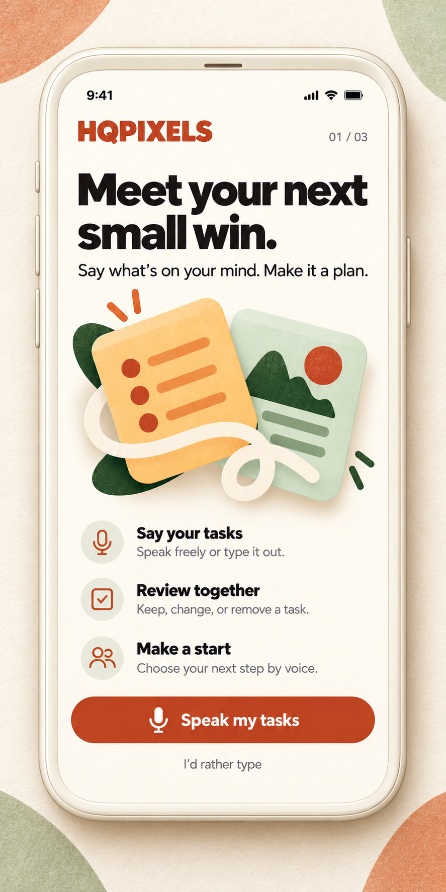
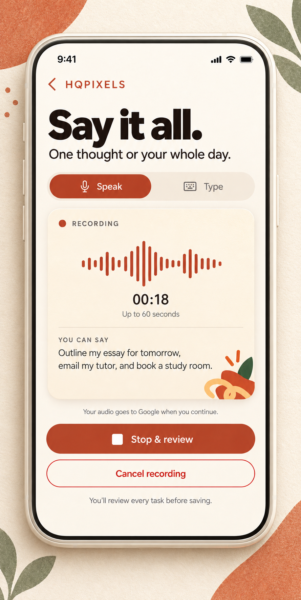
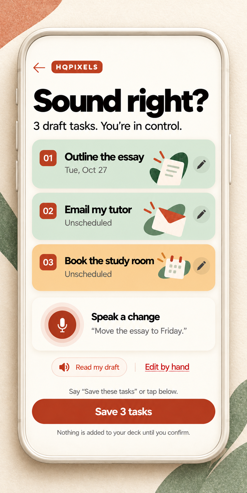

# HQPIXELS design and project draft

**Selected design: FLIP. Compact mark: HQ.**

<table>
<tr>
<td width="33%"></td>
<td width="33%"></td>
<td width="33%"></td>
</tr>
</table>

AI-generated presentation frames of the mobile design concepts. These illustrate the design direction, not implemented mobile screens. Original assets remain in <code>assets/</code>.

The shared [README frame assets](../docs/readme-frames/) include the [exact generation prompts](../docs/readme-frames/generation-log.json).

Open `index.html` for the visual gallery. This package contains the new logo and four core journey PNGs, plus the full implementation plan. It is a design/specification handoff, not a deployed application.

- `PROJECT-BRIEF.md` — product behavior, voice flow, Google setup, architecture, data/API contract, recovery and release gates.
- `BUILD-BACKLOG.md` — 24 implementation tasks with dependencies and acceptance criteria.
- `REPLIT-BUILD-PROMPT.md` — the build brief to use with Replit.
- `assets/` — HQPIXELS PNG logo, welcome, voice recording, draft review and voice task-selection screens.
- `tokens.css` — FLIP-derived tokens under the HQPIXELS name.
- `generation-log.json` — exact prompts and output locations; built-in image generation was used.
- `verification.json` — file integrity, transparency and local link verification.

Start with short spoken turns and reviewable drafts. Use Google Gemini for audio/text understanding and Google TTS for optional read-back. Add real-time Live API conversation later. All active tasks require explicit user confirmation; all interactions also support typing/tapping.

Google API free tiers have quotas. AI Pro interface benefits are separate from API billing; eligible Cloud credits require checking the account/project. No credentials, billing changes, live API tests or deployment are included in this draft delivery.

The original 60-frame comparison archive remains separate. Its FLIP direction is the visual source; the new four core screens and project brief supersede its corresponding capture/review behavior. Remaining original PNGs have not been regenerated. Use the HQPIXELS name throughout the eventual app.
